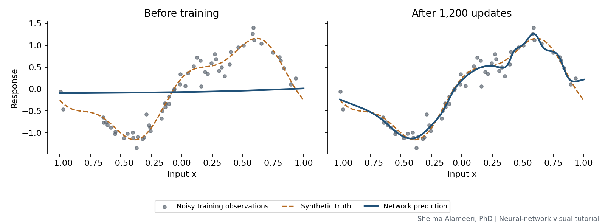

# Understanding neural networks through visual examples

**Author and maintainer: Sheima Alameeri, PhD**

A practical introduction to neural networks with Python, PyTorch, and freshly generated synthetic data. Follow a neuron from weights and biases to nonlinear prediction, then examine learning curves and overfitting.



## What is inside

| Topic | Visual example |
| --- | --- |
| Weights and biases | How slope and offset affect a neuron's pre-activation |
| Activations and architecture | Identity, ReLU, tanh, sigmoid, and a network schematic |
| Learning a nonlinear function | Predictions before and after training |
| Training and validation | Loss curves measured after the same optimizer updates |
| Overfitting | Validation-selected and final checkpoints, with an independent test set |
| Gradients | An automatic-differentiation check against finite differences |

**[Open the executed notebook](neural_network_visual_introduction.ipynb)** for the full explanation, runnable code, figures, and saved results.

## Run the tutorial

Use Python 3.11 or newer in this directory:

```bash
python -m venv .venv
# macOS/Linux:
source .venv/bin/activate
# Windows PowerShell instead:
# .venv\Scripts\Activate.ps1
python -m pip install -r requirements.txt
python run_tutorial.py
```

PyTorch's default installation can download optional accelerator dependencies on some platforms. For a CPU-only installation, install the pinned torch version from [PyTorch's official CPU wheel index](https://download.pytorch.org/whl/cpu) before installing the remaining requirements.

The runner executes this project's trusted plain-Python notebook cells in sequence and refreshes saved outputs. It does not require Jupyter. For interactive use, install JupyterLab separately, start `jupyter lab` from this directory, and open the notebook. Restart the kernel and run all cells after changes. No GPU, API key, external dataset, or dissertation code is needed.

## Reproducibility and interpretation

The notebook records package versions, fixes random seeds, uses CPU computation, and enables deterministic PyTorch algorithms. It checks the plotted activation functions, checkpoint restoration, finite numerical outputs, and a finite-difference gradient calculation. Exact reproduction is only expected in a compatible environment; results can differ across versions or hardware.

Validation data are kept out of gradient updates. A new test set is used only after checkpoint selection in the overfitting example. This is a single synthetic illustration, not evidence that more parameters or more training always harm generalization. The plotted network outputs are point predictions and do not provide uncertainty intervals.

## Project files

- `neural_network_visual_introduction.ipynb`: explanations, code, and saved outputs.
- `run_tutorial.py`: lightweight sequential notebook runner.
- `requirements.txt`: pinned versions of the principal dependencies.
- `assets/`: seven generated figures and CSV records of learning curves and checkpoint metrics.

## References and attribution

This tutorial presents established neural-network concepts through a standalone educational example. It does not claim a novel algorithm. The references credit theory and software usage; the figures are generated from the included experiments. Each graph carries the author credit.

- Goodfellow, I., Bengio, Y., and Courville, A. (2016). *Deep Learning*. MIT Press. [Chapter 6](https://www.deeplearningbook.org/contents/mlp.html), [Chapter 7](https://www.deeplearningbook.org/contents/regularization.html).
- [PyTorch: Optimizing Model Parameters](https://docs.pytorch.org/tutorials/beginner/basics/optimization_tutorial.html).

## Contact

**Sheima Alameeri, PhD**  
[sheima.alameeri@gmail.com](mailto:sheima.alameeri@gmail.com)

Related tutorial: [Gaussian-process regression: prediction and uncertainty](https://github.com/DrShaima/gp-regression-tutorial).
